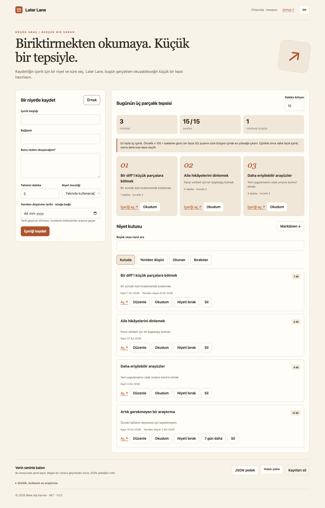

# Later Lane

A three-piece reading tray for saved posts and articles. Attach an intention and duration, choose a time budget and record what you took away.

[Open the app](https://metealpkarvan.github.io/later-lane/) · [Download 1.0.0](https://github.com/metealpkarvan/later-lane/releases/latest) · [Türkçe](README.tr.md)



## A complete small workflow

- Manual links with a required reading intention, duration estimate, priority and optional reconsideration date.
- An exact bounded subset search selects at most three eligible items within a 1–90 minute budget.
- Read, let go, renew and return-to-inbox actions; passing a reconsideration date never deletes an item.
- Turkish-aware search, edited records, one-sentence takeaways, Markdown and complete JSON backups.

All three projects from this research round have Turkish and English interfaces, fictional examples, local data, JSON recovery and zero runtime dependencies. Each project is independently usable.

## Try it

1. Click **Sample** to try a fictional four-link inbox.
2. Save a title, HTTP(S) link, reading intention and estimated minutes.
3. Set your available time. Open an original page from the tray, then mark it read and optionally write a takeaway.
4. Reconsider expired intentions; let them go or renew them without deleting their record.

The live app is the easiest path. For a downloaded copy, extract `later-lane-v1.0.0.zip` and open **index.html** in a modern browser. The release contains a prebuilt classic JavaScript bundle, so you do not need Node.js, a server or an API key to try it. Keep the ZIP and verify it against `SHA256SUMS.txt` if you want to check download integrity.

Browser storage for a `file:` page varies by browser and file location. Use JSON backups before moving the folder or switching between the live and downloaded app. If local saving is unavailable, the app warns you and keeps working in the current session.

## Data and limits

Up to 100 manually entered records. Estimated reading times and priorities are supplied by you. The tray score is priority × 100 plus days waiting, capped at 30; equal scores prefer more items, then fewer minutes, then input order. Passed reconsideration dates are excluded from the tray until renewed or returned to the inbox. External articles are not downloaded, summarized or cached. This does not import or repair X/Reddit bookmarks. The time budget resets on reload.

Data remains in this browser's local storage and is unencrypted. There is no analytics, authentication, cloud sync or AI request. Clearing browser data can remove records. The app host receives ordinary page/asset requests; your saved text is not uploaded. External links are visited only on your action. A corrupt local archive blocks writes and offers the original bytes for recovery. A valid import asks before replacing data and downloads the current archive as a recovery copy first. Backup imports are bounded to 3 MB and the app's schema.

On HTTPS or localhost the interface is cached after its first online visit. This caches the app shell, not linked web pages. A downloaded copy runs from its own local files. Language changes translate controls without rewriting user content.

## Why build this?

The design comes from an exploratory snapshot of **three public X posts and eight Reddit threads**, accessed on 2026-10-05. Primary posts, partial-text limits, cached-date uncertainty, competing approaches and product hypotheses are explained in [Research](docs/RESEARCH.md) and the [full evidence ledger](docs/COMMUNITY-RESEARCH-2026-10-05.md). Posts do not establish adoption or measured effectiveness.

## Development and verification

```bash
npm test
npm run build
npm start
```

Tests/build require Node.js 22+; `npm start` uses Python 3 to serve `dist/` at localhost:8080. End users opening the release ZIP need neither runtime. There are **39 automated rule and packaging checks**. Browser acceptance also covers editing, exports, backup restore, data recovery, translations, mobile layout and offline reload; see [Verification](docs/VERIFICATION.md).

CI runs on Linux with Node 22/24 and native **Intel (x64) and Apple Silicon (arm64) Mac runners**. HTML/CSS/JavaScript runtime files use the browser on either processor and require no Rosetta. Browser acceptance on the local Intel Mac is a separate record, not proof of every browser or older macOS version.

[Architecture](docs/ARCHITECTURE.md) · [Design decisions](docs/DESIGN.md) · [Roadmap](docs/ROADMAP.md) · [Contributing](CONTRIBUTING.md)

MIT © 2026 Mete Alp Karvan
